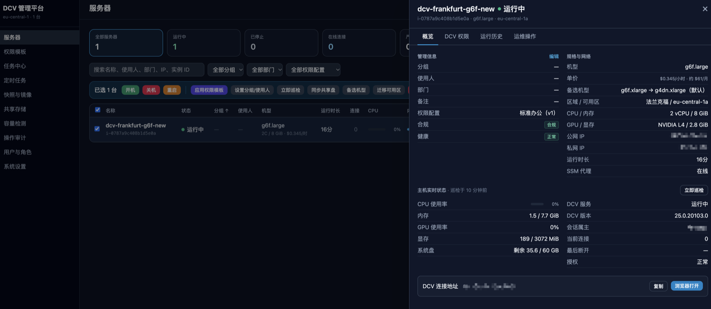
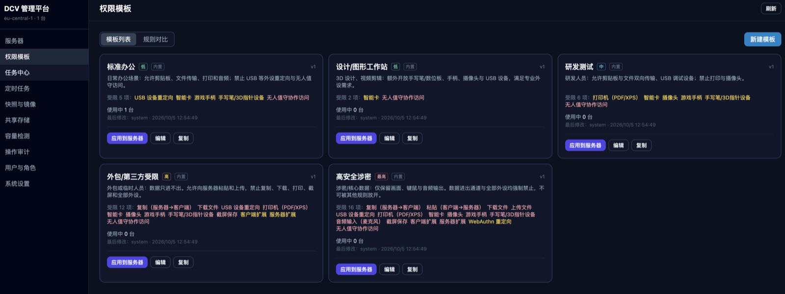
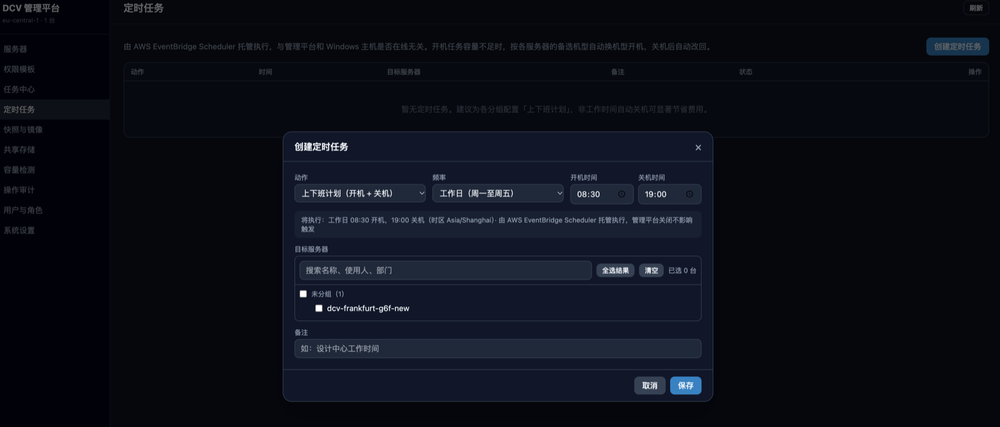
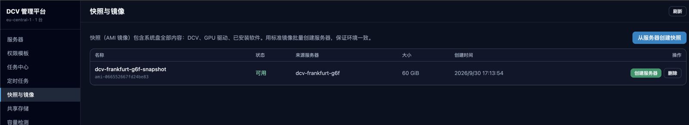
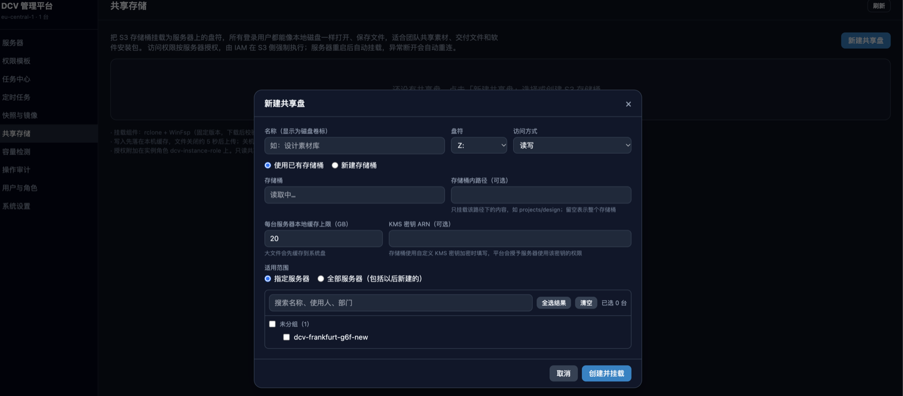
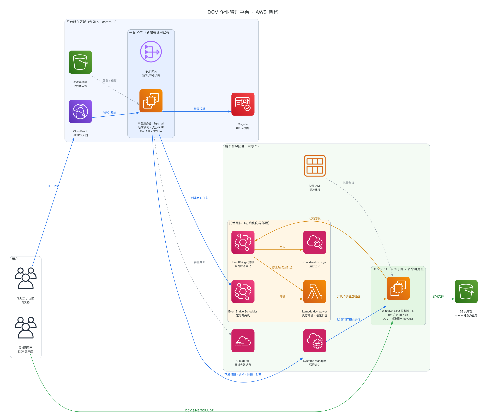

# DCV 企业管理平台

统一管理 AWS 上的 Amazon DCV Windows GPU 云桌面：批量开关机、权限模板、定时任务、容量与备选机型、跨可用区迁移、共享存储、快照批量交付、巡检合规、多区域、用户与审计。

---

## 目录
1. [场景与需求](#1-场景与需求)
   - [界面预览](#13-界面预览)
2. [架构说明](#2-架构说明)
3. [方案说明](#3-方案说明)
4. [代码结构](#4-代码结构)
5. [成本测算](#5-成本测算)
6. [部署说明](#6-部署说明)
7. [运维与已知限制](#7-运维与已知限制)

---

## 1. 场景与需求

### 1.1 业务场景
企业为设计、研发、外包等人员提供 GPU 云桌面（Windows + Amazon DCV），规模为 20–100 台，部署在一个或多个 AWS 区域。用户通过 DCV 客户端或浏览器连接云桌面；IT 运维集中管理，按岗位控制剪贴板、文件传输、USB、打印等能力，非工作时间自动关机以节省费用。

### 1.2 核心需求
| 类别 | 需求 |
|------|------|
| 统一运维 | 一个控制台管理所有服务器；支持批量开关机、批量下发权限、批量巡检；所有操作有结果和审计记录 |
| 权限管控 | 企业级权限模板（标准办公、设计、研发、外包、涉密），按模板批量下发并检测是否被篡改；登录用户是**标准用户**，不能自行修改 DCV 权限 |
| 定时开关机 | 由 **AWS 托管服务**执行（EventBridge Scheduler），不依赖 Windows 主机或平台是否在线 |
| 容量保障 | GPU 机型可能缺货：要能检测各可用区容量；开机缺货时自动换备选机型；可用区长期缺货时能整机迁移 |
| 环境交付 | 用标准快照批量创建服务器，开机后自动应用权限模板、挂载共享盘 |
| 共享存储 | 基于 S3 的共享盘，可只读/读写，可限定服务器 |
| 账号与安全 | 平台用户用 Cognito 管理，分管理员、运维、只读三种角色；可重置 DCV 登录密码（密码不落日志） |
| 多区域 | 同一平台管理多个区域，日常操作不需要切换区域 |
| 费用可见 | 显示机型单价、月费估算与临时换机型的价格差 |
| 可部署 | 一键部署到 AWS，支持新建或使用已有 VPC；部署后在控制台从零完成初始化 |

允许的机型（可在系统设置中调整）：g6f.large、g6f.xlarge、g6f.2xlarge，以及作为备选的 g4dn.xlarge、g5.xlarge。

### 1.3 界面预览

**服务器列表与详情**：汇总卡片、筛选、批量操作；详情中有管理信息、规格与单价、备选机型、主机实时状态（CPU、内存、显存、DCV 会话、授权）。


**权限模板**：5 个内置企业模板，按风险等级区分，列出受限项；可一键应用到多台服务器，也可对比模板规则。


**定时任务**：由 AWS EventBridge Scheduler 托管执行。「上下班计划」一次创建开机和关机两个任务；开机时容量不足会自动换备选机型。


**快照与镜像**：从标准快照批量创建服务器，可选机型（显示单价）、可用区策略，以及开机后自动应用的权限模板和共享盘。


**共享存储**：把 S3 存储桶挂载为服务器上的盘符，可选只读或读写，可限定服务器；访问权限由 IAM 在 S3 侧强制执行。


---

## 2. 架构说明

### 2.1 总体架构



图例：**蓝线**为管理操作（平台调用 AWS API）；**橙线**为 AWS 托管执行（平台停机也照常运行）；**绿线**为用户访问与文件读写（不经过平台）；**灰色虚线**为辅助流程。图由 `docs/architecture.py` 生成，修改后执行 `.venv/bin/python docs/architecture.py` 即可更新。

### 2.2 组件说明
| 组件 | 作用 | 说明 |
|------|------|------|
| 平台服务器 | 运行管理平台（FastAPI 后端 + 单文件 React 前端） | Amazon Linux 2023、t4g.small；放在私有子网，没有公网 IP；数据在加密 EBS 上的 SQLite；使用实例角色，不需要访问密钥 |
| CloudFront | 平台的 HTTPS 入口 | 使用 VPC 源站直连私有子网中的实例；安全组只放行 CloudFront 源站地址段；不缓存，透传 API |
| Cognito | 平台用户登录与角色 | 用户名密码登录，签发 JWT；三个用户组对应三种角色；首次登录强制改密 |
| DCV 服务器 | 用户的 GPU 云桌面 | Windows + NVIDIA GRID 驱动 + Amazon DCV；会话属主是标准用户 dcvuser；通过 SSM 接受平台管理（无需开放 RDP） |
| EventBridge Scheduler | 定时开关机 | 按区域创建；开机目标是托管开机函数，关机/重启直接调用 EC2 |
| Lambda `dcv-power` | 托管开机 | 原机型容量不足时按备选机型重试；实例停止后改回原机型 |
| EventBridge 规则 | 状态记录与改回机型 | `dcv-instance-state-change` 把状态变化写入日志（运行历史）；`dcv-fallback-revert` 在停止时触发函数 |
| S3 共享盘 | 团队共享文件 | 主机上用 rclone + WinFsp 挂载为盘符；按共享盘生成 IAM 策略控制访问 |
| 快照（AMI） | 标准环境 | 平台创建的快照带 `dcv-snapshot=true` 标签；可复制到其他区域 |

### 2.3 关键数据流
- **控制面**：浏览器 → CloudFront → 平台 → AWS API（EC2、SSM、IAM、Scheduler、Lambda、CloudTrail、Pricing）。对主机的操作（下发权限、巡检、挂载共享盘、改密、显卡自检）全部通过 SSM Run Command 以 SYSTEM 身份执行。
- **数据面**：用户 → DCV 服务器（8443 TCP + UDP/QUIC），不经过平台；共享盘流量在主机与 S3 之间直连。
- **托管执行**：定时开关机、容量不足换机型、关机改回机型由 AWS 服务完成，平台停机也不受影响。

---

## 3. 方案说明

### 3.1 服务器纳管与批量任务
- 带标签 `dcv=true` 的 EC2 实例自动纳管。分组、使用人、部门、备注保存为 EC2 标签（`dcv:group` 等），在 AWS 控制台和成本分摊报表中同样可用。
- 批量操作（开关机、应用模板、巡检、同步共享盘、迁移）作为**任务**执行，逐台记录结果，可重试失败项。同一台服务器同时只允许一个未完成的任务（冲突时返回 409）；平台重启时，未完成的任务标记为失败。

### 3.1.1 删除服务器
管理员可以在批量操作栏或服务器详情的「运维操作」中删除服务器（终止实例），删除后不可恢复：
- **确认**：需输入服务器名称（批量时输入「删除 N 台」）确认。有用户正在连接或有未完成任务的服务器默认不能删除，有连接的服务器需勾选「仍然删除」。开启了 EC2 终止保护的服务器会被拒绝删除。
- **可选备份**：删除前制作含全部磁盘的备份快照，快照可用后才删除服务器；备份制作失败时不删除。备份显示在「快照与镜像」中，可用来恢复。
- **同步清理**：
  - 平台数据：权限模板绑定、自定义权限、备注、巡检记录。
  - 共享盘授权：重建对应的 IAM 策略。
  - 定时任务：从中移除该服务器；只剩这台服务器的定时任务会被删除。
  - 弹性 IP：解除关联，但保留在账号中。
- **数据盘**：未设置「随实例删除」的数据盘会保留，并在任务结果中列出（这些盘仍在计费）。

### 3.2 DCV 权限管控
- **5 个内置模板**：标准办公、设计/图形工作站、研发测试、外包/第三方受限、高安全涉密；也可以自定义模板。模板有版本号，按内容比对判断服务器是否需要重新应用。
- **下发方式**：平台通过 SSM 写入权限文件 `C:\dcv\console.perm`，并写入开机自动会话配置（`HKEY_USERS\S-1-5-18\...\dcv`），重启后仍然有效。下发后读取主机上的实际文件核对。
- **防篡改**：
  - 会话属主 dcvuser 是**标准用户**，没有权限修改权限文件、注册表或服务。
  - 后台每 10 分钟巡检，发现文件被改会标记为「配置偏离」，并提示一键重新下发。
  - 如果会话属主是管理员，会给出告警。

### 3.3 定时开关机（AWS 托管）
- **执行方**：定时任务保存在 EventBridge Scheduler 中，与平台和主机是否在线无关。支持「上下班计划」，一次创建开机和关机两个任务。
- **按区域执行**：调度是区域级资源。选中多个区域的服务器时，平台自动按区域拆成多个定时任务。
- **开机路径**：开机任务调用托管开机函数，按各服务器的备选机型处理容量不足；失败时由 Lambda 异步重试 2 次。

### 3.4 容量检测、备选机型与迁移
AWS 没有接口能直接查询某个可用区的剩余 GPU 容量。平台按「可用区 × 机型」逐格判断，综合四种信号，按可靠程度从高到低采用：

| 优先级 | 信号 | 获取方式 |
|------|------|------|
| 1 | 实测 | 创建 N 台按需容量预留并立即取消，代表「此刻能开出 N 台」，费用可忽略 |
| 2 | 真实开机失败 | CloudTrail 中最近 60 分钟因容量不足失败的开机和创建记录 |
| 3 | Spot 放置分数 | 1–10 分，只作参考 |
| 4 | 是否提供 | 该机型是否在该可用区销售 |

另外单独显示 G 系列 vCPU 配额的剩余量。

应对缺货的三层手段：
1. **备选机型**：开机时原机型容量不足，在同一可用区按顺序改用备选机型（默认 g6f.xlarge → g4dn.xlarge → g5.xlarge），关机后自动改回原机型。实测同一个 GRID 驱动同时支持 L4 分片、T4、L4 整卡，不用重装驱动。
2. **开机显卡自检**：主机上的 SYSTEM 计划任务 `\DCV\DCV-GPU-Guard`。换显卡后首次开机，Windows 需要几分钟配置驱动；自检会等它自行就绪，最多 10 分钟，仍不正常才重启一次。巡检发现显卡异常会显示严重告警。
3. **跨可用区迁移**：某可用区长期缺货时使用，流程为：
   1. 实测目标可用区容量，没有容量就不做任何改动。
   2. 制作含全部磁盘的镜像。
   3. 在目标可用区按原配置重建服务器。
   4. 检查新服务器的 SSM 和 DCV 是否正常。
   5. 把模板绑定、权限、共享盘授权、定时任务、弹性 IP 转到新服务器。
   6. 删除原服务器。

   实测每台约 5–30 分钟；迁移前的镜像保留为备份。

### 3.5 快照与批量交付
- 从服务器创建快照（不重启）；从快照批量创建服务器，最多 20 台。可用区可选三种方式：自动选择（按容量排序，缺货时自动换下一个）、多可用区均衡分布、指定可用区。
- 新服务器上线后自动应用指定的权限模板（标签 `dcv:pending-template`），并挂载共享盘。
- 快照可以「复制到区域」，在其他区域交付相同的环境。

### 3.6 S3 共享盘
- **挂载方式**：rclone v1.75.1 + WinFsp 2.1，安装包校验 SHA256；以 SYSTEM 计划任务运行，所有用户看到的盘符相同，进程被结束后自动恢复。
- **访问控制**：
  - 每个共享盘生成一份 IAM 托管策略（`/dcv-manager/dcv-share-<id>-0`），附加到服务器实例角色上。
  - 「指定服务器」范围用 `Deny` + `aws:userid` 条件实现，上限 110 台。
  - 同一存储桶内的路径不能相互包含。
- **同步**：服务器正忙时，共享盘改动会登记为待同步，任务结束后自动补做；后台巡检发现缺失时自动补挂。

### 3.7 巡检与告警
后台每 10 分钟巡检一次，每个区域单独下发，每批 50 台。检查内容：
- DCV 服务状态、会话属主、当前连接数、授权状态
- CPU、内存、显存、磁盘
- 权限文件是否与平台记录一致
- 共享盘挂载状态
- 显卡驱动是否就绪

还会给出闲置提醒：运行中但超过 2 小时无人连接。

### 3.8 用户、审计与运行历史
- **用户与角色**：Cognito 中三个用户组对应三种角色：admin（全部操作）、operator（运维操作）、viewer（只读）。限制：用户不能修改自己的角色；系统会保护最后一名管理员。
- **密码**：
  - 平台密码：用户可以自助修改。
  - DCV 登录密码：由平台重置。密码经 SSM SecureString 中转，主机读取后立即删除，不出现在命令记录中。
- **运行历史**：综合 EventBridge 状态日志、CloudTrail 与平台审计，展示每台服务器的运行时段和操作人。所有平台操作都写入审计，可在「操作审计」页查询。

### 3.9 多区域
- **新增区域**：在系统设置中新增区域，为该区域配置网络、安全组、密钥对，并部署托管组件。
- **设置分两层**：
  - 每个区域各自保存：VPC、子网、安全组、密钥对。
  - 对所有区域生效：实例角色、允许的机型、备选机型、时区、巡检设置。
- **自动路由**：所有针对服务器的操作自动在服务器所在区域执行。服务器列表、快照、定时任务跨区域汇总；容量检测按区域查看；迁移只能在同一区域内进行。
- **DCV 授权**：实例角色会被授权读取每个管理区域的授权存储桶 `dcv-license.<区域>`。缺少这个授权时，该区域服务器的 DCV 会显示未授权。

### 3.10 机型单价
- **来源**：通过 AWS Price List API 查询各区域按需价格（Windows），缓存 24 小时。
- **显示位置**：服务器列表、详情、创建、更改机型、备选机型、迁移、容量检测、初始化向导。
- **月费口径**：按每天 8 小时 × 22 天（176 小时）估算，鼠标悬停可看全天运行（730 小时）的金额。

### 3.11 安全设计
| 方面 | 措施 |
|------|------|
| 入口 | 只能通过 CloudFront 的 HTTPS 访问；平台服务器没有公网 IP，安全组只放行 CloudFront 源站地址段 |
| 身份 | Cognito：密码至少 12 位，需包含大小写字母、数字和符号；仅管理员可创建用户；首次登录强制改密；令牌有效期 8 小时 |
| 平台权限 | 实例角色 `dcvmgr-platform-<区域>`，按功能逐项授权的最小权限（见 6.7）：只能操作带 `dcv=true` 标签的服务器；只能管理 `dcv-*` 角色、函数和规则，以及 `/dcv-manager/` 下的策略；**不能修改自身权限**；不能读取任何 S3 数据或密钥 |
| 主机 | 会话用户是标准用户；默认不开放 RDP，运维全部通过 SSM；新建安全组按功能最小放行（见下表） |
| 数据 | 平台磁盘加密；部署存储桶默认加密，禁止公开访问；共享盘存储桶开启版本控制，旧版本保留 30 天 |

**初始化向导新建的安全组默认规则**

| 方向 | 协议 / 端口 | 来源 / 目标 | 用途 |
|------|------|------|------|
| 入站 | TCP 8443 | 填写的来源网段（建议公司出口 IP） | DCV 连接 |
| 入站 | UDP 8443 | 同上 | DCV QUIC 传输（画面更流畅） |
| 入站（可选，默认关闭） | TCP 3389 | 单独填写，不允许 0.0.0.0/0 | RDP 维护 |
| 出站 | TCP 443 | 0.0.0.0/0 | SSM 远程管理、AWS API、S3 共享盘、DCV 授权、驱动与组件下载、Windows 更新 |
| 出站 | TCP 80 | 0.0.0.0/0 | Windows 更新、证书吊销检查（CRL / OCSP） |
| 出站 | TCP 1688 | 169.254.169.250/32、169.254.169.251/32 | Windows 激活（AWS KMS 服务器） |
| 出站 | UDP 123 | 169.254.169.123/32 | 时间同步（Amazon Time Sync） |

- 默认的「放行全部出站」规则会被移除。如果服务器上的业务软件需要访问其他端口（例如许可证服务器、数据库），可以在向导中选择「放行全部出站」。
- 选择已有安全组时，检查项会核对：DCV 端口是否放行、出站 443 是否放行、RDP 是否对全互联网开放。

---

## 4. 代码结构

```
dcv-manager/
├── backend/                     # 后端（Python 3.11+，FastAPI）
│   ├── app.py                   # HTTP 接口、鉴权、启动流程（约 1400 行）
│   ├── config.py                # 配置：settings.json > 环境变量 > 默认值；多区域配置
│   ├── aws_service.py           # AWS 访问层：按区域路由的客户端、服务器发现、电源、快照、创建服务器
│   ├── jobs.py                  # 批量任务引擎、后台巡检、自动补挂、显卡自检部署、迁移任务
│   ├── store.py / db.py         # SQLite 数据层：模板、绑定、任务、巡检、共享盘、审计
│   ├── dcv_service.py           # DCV 权限下发、会话状态、重置密码
│   ├── inspect_service.py       # 巡检脚本与合规评估
│   ├── templates_builtin.py     # 5 个内置权限模板
│   ├── dcv_features.py          # DCV 权限项定义
│   ├── eb_scheduler.py          # EventBridge Scheduler（多区域）
│   ├── capacity_service.py      # 容量检测、实测、可用区排序
│   ├── migrate_service.py       # 跨可用区迁移
│   ├── terminate_service.py     # 删除服务器：备份、终止、清理平台引用
│   ├── gpu_guard.py             # 开机显卡自检（主机侧计划任务）
│   ├── share_service.py         # S3 共享盘：存储桶、IAM 策略、主机挂载脚本、状态评估
│   ├── history_service.py       # 运行历史（日志 + CloudTrail + 审计）
│   ├── pricing_service.py       # 机型单价（Price List API）
│   ├── setup_service.py         # 初始化向导：资源发现、检查、创建、按区域配置
│   └── cognito_auth.py          # Cognito 登录、首次改密、JWT 校验、用户与角色管理
├── frontend/
│   └── index.html               # 单文件前端（React 18 + Tailwind，浏览器端编译 JSX）
├── lambda/dcv_power/handler.py  # 托管开机函数：备选机型、关机改回
├── deploy/                      # AWS 部署
│   ├── platform.yaml            # CloudFormation 模板
│   ├── deploy.sh                # 一键部署 / 更新
│   ├── platform-role-policy.json # 平台角色最小权限策略（由 render_policy.py 从模板生成）
│   ├── render_policy.py         # 导出 / 校验最小权限策略
│   └── destroy.sh               # 删除平台（可选同时清理 DCV 资源）
├── provisioning/
│   ├── dcv-bootstrap.ps1        # 从 Windows 基础镜像全新安装 DCV 主机的初始化脚本
│   └── deploy_power_function.py # 命令行部署托管组件（与向导相同）
├── docs/
│   ├── architecture.py / .png   # AWS 架构图（diagrams 生成）
│   └── screenshots/             # 界面截图
├── tests/                       # 单元测试（111 项，不访问 AWS）
├── run.sh                       # 本地开发启动
└── requirements.txt / requirements-dev.txt
```

主要接口（均需登录；具体权限见 `app.py` 中的 `VIEWER` / `OPERATOR` / `ADMIN`）：

| 前缀 | 功能 |
|------|------|
| `/api/login`、`/api/login/new-password`、`/api/me` | 登录、首次改密、当前用户 |
| `/api/instances` | 服务器列表与汇总；单台的电源、权限、改机型、改密、快照、历史、容量建议 |
| `/api/jobs/*` | 批量任务：`power`、`apply-template`、`inspect`、`share-sync`、`migrate`、`terminate` |
| `/api/templates` | 权限模板 |
| `/api/schedules` | 定时任务 |
| `/api/images` | 快照：创建服务器、复制到区域、删除 |
| `/api/shares` | 共享盘 |
| `/api/capacity` | 容量检测与实测 |
| `/api/prices` | 机型单价 |
| `/api/users`、`/api/audit` | 用户与角色、操作审计 |
| `/api/setup/*` | 系统设置：检查、资源发现、执行初始化、新增/移除区域 |

---

## 5. 成本测算

按法兰克福（eu-central-1）按需价格估算，单位为美元/月，价格来自 AWS Price List API（2026-10 查询）。不含税；实际费用以账单为准。

### 5.1 平台本身（固定成本）
| 项目 | 单价 | 月费 | 说明 |
|------|------|------|------|
| 平台服务器 t4g.small | $0.0192/小时 | $14.0 | 全天运行 |
| 平台磁盘 20 GB gp3 | $0.0952/GB·月 | $1.9 | |
| NAT 网关 | $0.052/小时 + $0.052/GB | $38.2 | 仅新建 VPC 模式；使用已有 VPC 的 NAT 时为 0 |
| NAT 公网 IPv4 | $0.005/小时 | $3.7 | 同上 |
| CloudFront | 按流量 | ≈ $0 | 管理流量很小，通常在免费额度内 |
| Cognito | 按月活用户 | ≈ $0 | 管理员数量很少，在免费额度内 |
| 托管组件（Scheduler、Lambda、日志） | 按量 | < $1 | 每个管理区域 |
| **合计** | | **约 $59**（使用已有 NAT 时约 **$17**） | |

### 5.2 每台 DCV 服务器
| 项目 | 单价 | 上班时间（176 小时/月） | 全天运行（730 小时/月） |
|------|------|------|------|
| g6f.xlarge 计算（Windows） | $0.481/小时 | $84.7 | $351.1 |
| 系统盘 60 GB gp3 | $0.0952/GB·月 | $5.7（关机也计费） | $5.7 |
| 公网 IPv4 | $0.005/小时 | $0.9（关机后释放） | $3.7 |
| DCV 流量出网 | $0.09/GB | 约 $4（按每个工作日 2 GB 估算） | 约 $4（流量取决于使用时长，而非开机时长） |
| **每台合计** | | **约 $95** | **约 $365** |

其他机型的计算单价（Windows 按需）：

| 机型 | 单价 | 上班时间月费 | 相对 g6f.xlarge |
|------|------|------|------|
| g6f.large | $0.345/小时 | $60.7 | -28% |
| g6f.2xlarge | $0.962/小时 | $169.3 | +100% |
| g4dn.xlarge | $0.842/小时 | $148.2 | +75% |
| g5.xlarge | $1.442/小时 | $253.8 | +200% |

### 5.3 规模测算（g6f.xlarge，上班时间开机，含平台新建 VPC 费用）
| 规模 | DCV 服务器 | 平台 | 每月合计 | 若全天运行 |
|------|------|------|------|------|
| 20 台 | $1,905 | $59 | **约 $1,960** | 约 $7,360 |
| 50 台 | $4,763 | $59 | **约 $4,820** | 约 $18,310 |
| 100 台 | $9,525 | $59 | **约 $9,580** | 约 $36,560 |

### 5.4 其他按量费用
| 项目 | 单价 | 示例 |
|------|------|------|
| 快照存储 | $0.054/GB·月 | 一个 60 GB 系统盘快照（增量，实际约 20–40 GB）约 $1–3 |
| 跨区域复制快照 | 约 $0.02/GB | 60 GB 约 $1.2 |
| S3 共享盘 | $0.0245/GB·月 | 1 TB 约 $25（另有请求费） |
| 容量实测 | 按秒计费 | 每次几秒，可忽略 |
| 临时换用备选机型 | 按备选机型单价 | 例如当天以 g4dn.xlarge 运行 8 小时，比 g6f.xlarge 多约 $2.9 |

### 5.5 降本建议
- **定时关机（最有效）**：上班时间开机相比全天运行可节省约 75%。
- **处理闲置机器**：留意平台的闲置提醒，及时关机。
- **节省计划**：用量稳定的部分可购买 Savings Plans，折扣只作用于计算费用，不含 Windows 许可费，具体折扣以 AWS 报价为准。
- **容量预留**：只给关键岗位购买（不开机也计费，g6f.xlarge 约 $351/月），不建议全员购买。
- **用已有 NAT**：多个系统共用一个 VPC 时，部署平台时选择已有 VPC，可省掉约 $42/月的 NAT 网关和公网 IP 费用。

---

## 6. 部署说明

### 6.1 前提条件
- AWS 账号，部署人具有管理员权限（需要创建 IAM 角色、CloudFront、VPC 等）。
- 本机安装：AWS CLI v2（已配置凭证）、`bash`、`tar`、`python3`。
- 准备一个 DCV 服务器快照（AMI），并打上标签 `dcv-snapshot=true`，获取方式见下一节。
- 目标区域需有 G 系列 vCPU 配额：每台 g6f.xlarge 需要 4 vCPU，规模较大时需在 Service Quotas 申请提高。

### 6.1.1 获取 DCV 标准镜像（AMI）
平台从带 `dcv-snapshot=true` 标签的快照批量创建服务器。可以通过以下两种方式获得镜像：

- **方式一：使用我们共享的标准镜像。**
  - 镜像内容：Windows Server 2022、NVIDIA GRID 驱动（支持 g6f / g4dn / g5 / g6）、Amazon DCV Server，以及标准用户 `dcvuser`。
  - 申请方式：**如果需要共享 AMI，请留言**（提 Issue 或联系维护人），注明 AWS 账号 ID 和目标区域，我们会把镜像共享给你的账号。
  - 收到共享后，在你的账号里复制一份，再打上标签：
    ```bash
    aws ec2 copy-image --region eu-central-1 --source-region eu-central-1 --source-image-id <共享的 AMI ID> --name dcv-standard
    aws ec2 create-tags --region eu-central-1 --resources <复制得到的 AMI ID> --tags Key=dcv-snapshot,Value=true Key=Name,Value=DCV标准镜像
    ```
    复制成功后，快照会出现在平台的「快照与镜像」中；要用到其他区域时，用平台的「复制到区域」即可。
- **方式二：自己制作。**
  1. 用 `provisioning/dcv-bootstrap.ps1` 从 Windows 基础镜像新建一台 DCV 服务器。
  2. 装好业务软件。
  3. 在平台「运维操作 → 创建快照」，平台会自动打上标签。

> **安全提示**
> - 共享镜像中 `dcvuser` 和本地管理员的初始密码会单独告知，不写在本文档中。
> - 用同一镜像创建的服务器密码都相同。创建后请在平台中逐台「重置 DCV 登录密码」。
> - 共享镜像未做系统通用化（Sysprep）：服务器的计算机名相同，在 EC2 控制台也无法获取 Administrator 密码。日常运维通过 SSM 进行，不需要这个密码。


### 6.2 部署平台
```bash
# 方式一：新建 VPC（公有子网 + NAT 网关 + 私有子网），默认 eu-central-1
./deploy/deploy.sh --region eu-central-1

# 方式二：使用已有 VPC
#   要求：子网是私有子网，且能经 NAT 或中转网关访问互联网；VPC 挂有互联网网关（CloudFront VPC 源站的要求）
./deploy/deploy.sh --region eu-central-1 --vpc vpc-xxxxxxxx --subnet subnet-xxxxxxxx

# 其他选项
#   --stack NAME          堆栈名（默认 dcv-manager）
#   --vpc-cidr CIDR       新建 VPC 的网段（默认 10.90.0.0/24）
#   --instance-type TYPE  平台服务器机型（默认 t4g.small）
#   --admin NAME          初始管理员用户名（默认 admin）
#   --admin-email EMAIL   管理员邮箱（可选）
```
脚本会依次执行：
1. 检查凭证与网络参数。
2. 创建部署存储桶，打包并上传代码。
3. 创建 CloudFormation 堆栈（首次约 15–25 分钟）。
4. 创建管理员。
5. 检查访问。

结束时输出：
```
平台地址：https://dxxxxxxxxxxxx.cloudfront.net
管理员：  admin
临时密码：xxxxxxxxxxxxxxxx     （仅显示这一次；首次登录时需设置新密码，7 天内有效）
```

### 6.3 首次使用（从零初始化）
1. **登录**：打开平台地址，用 `admin` 和临时密码登录，按提示设置新密码。
2. **初始化**：进入「系统设置 → 开始初始化」，按向导完成：
   1. **区域**：选择 DCV 服务器所在区域，页面显示各区域有几个可用区提供 g6f。
   2. **网络**：使用已有 VPC 时，每个可用区勾选一个公有子网；新建 VPC 时，填写网段并勾选可用区，向导自动创建子网、互联网网关和路由表。
   3. **安全组**：选择已有安全组，或新建（只放行 DCV 8443 TCP+UDP，来源网段建议填公司出口 IP）。
   4. **主机权限**：选择或新建实例角色（新建时默认名 `dcv-instance-role`）；选择或新建密钥对（新建时私钥只下载一次）。
   5. **机型与策略**：允许的机型、默认备选机型、系统盘大小、时区、巡检间隔；勾选「部署或更新托管组件」。
   6. **确认并执行**：先预检，再执行；完成后平台自动重启。
3. **创建服务器**：在「快照与镜像」中选择快照 →「创建服务器」，选择机型、数量、可用区、开机后自动应用的权限模板和共享盘。
4. **按需配置**：在「定时任务」中创建上下班计划；在「共享存储」中添加共享盘；在「用户与角色」中添加运维和只读用户。
5. **多区域（可选）**：在「系统设置 → 新增区域」中添加其他区域，并用「复制到区域」把快照复制过去。

### 6.4 更新与删除
```bash
# 更新代码（堆栈有变更时同时更新堆栈；数据库与设置保留）
./deploy/deploy.sh --region eu-central-1

# 只删除平台：堆栈（平台服务器、CloudFront、Cognito、平台 VPC）和部署存储桶
./deploy/destroy.sh --region eu-central-1

# 同时删除平台在这些区域创建的 DCV 资源
#   包括：DCV 服务器、定时任务、托管组件、向导新建的 VPC 与安全组，以及 dcv-* 角色和 /dcv-manager/ 策略
#   不删除：快照与共享盘存储桶
./deploy/destroy.sh --region eu-central-1 --purge-dcv eu-central-1,eu-west-2
```
> 删除 Cognito 用户池会删除所有平台账号；平台数据库在平台服务器磁盘上，随堆栈一起删除。如需保留，请先通过 SSM 备份 `/var/lib/dcv-manager/`。

### 6.5 本地开发
```bash
python3 -m venv .venv && .venv/bin/pip install -r requirements-dev.txt
.venv/bin/python -m pytest -q tests          # 单元测试
DCV_ADMIN_PASSWORD='本地口令' ./run.sh        # 本地启动 http://127.0.0.1:8000（未配置 Cognito 时使用单一口令登录）
```
本地运行使用当前 AWS CLI 凭证访问 AWS。

### 6.6 配置项
平台在 AWS 上运行时，环境变量由部署脚本写入 `/etc/dcv-manager/env`；资源配置由「系统设置」保存在 `/var/lib/dcv-manager/settings.json`。优先级：`settings.json` > 环境变量 > 默认值。

| 环境变量 | 说明 | 默认 |
|------|------|------|
| `AWS_REGION` | 主区域 | `eu-central-1` |
| `COGNITO_USER_POOL_ID` / `COGNITO_CLIENT_ID` | Cognito 用户池与应用客户端 | 部署时自动设置 |
| `DCV_DB_PATH` / `DCV_SETTINGS_PATH` | 数据库与设置文件路径 | `/var/lib/dcv-manager/` |
| `DCV_TAG_KEY` / `DCV_TAG_VALUE` | 纳管标签 | `dcv` / `true` |
| `DCV_INSPECT_INTERVAL_MIN` | 后台巡检间隔（分钟，0 为关闭） | `10` |
| `DCV_IDLE_HOURS` | 闲置提醒时长（小时） | `2` |
| `DCV_MAX_LAUNCH_COUNT` | 单次批量创建上限 | `20` |

### 6.7 平台角色的最小权限
平台服务器的实例角色只授予平台功能实际用到的权限：
- 用 `deploy.sh` 部署时，权限已写在 `deploy/platform.yaml` 中。
- 不用本仓库的 CloudFormation、自行创建角色时，使用独立的策略文件 `deploy/platform-role-policy.json`。替换其中的占位符后，作为内联策略附加到角色上，同时附加托管策略 `AmazonSSMManagedInstanceCore`：
  - `${AWS::AccountId}`：AWS 账号 ID
  - `${ArtifactBucket}`：部署存储桶名称
  - `${UserPool.Arn}`：Cognito 用户池 ARN

修改 `platform.yaml` 中的策略后，执行 `python deploy/render_policy.py` 重新生成 JSON。单元测试会检查两者是否一致。

| 功能 | 授权范围 |
|------|------|
| 服务器管理（电源、改机型、快照、删除、标签） | 只能操作带 `dcv=true` 标签的实例；新建实例必须带该标签 |
| 远程命令（权限下发、巡检、挂载、改密、显卡自检） | `ssm:SendCommand` 只能发给带 `dcv=true` 标签的实例，且只能使用 `AWS-RunPowerShellScript` 文档 |
| 改密中转参数 | 只能写入和删除 `/dcv-manager/*` 参数（使用 AWS 托管密钥 aws/ssm，不需要 KMS 权限） |
| 容量实测 | 只能创建带 `dcv:capacity-probe` 标签的容量预留，也只能取消这类预留 |
| 快照 | 创建与跨区域复制；只能注销带 `dcv-snapshot=true` 标签的镜像 |
| 初始化向导 | 新建 VPC、子网、网关、路由表、安全组、密钥对；只能修改向导新建（带 `dcv:managed-by` 标签）的安全组规则 |
| IAM | 只能创建和修改 `dcv-*` 角色与实例配置文件；只能附加 `AmazonSSMManagedInstanceCore`、`AWSLambdaBasicExecutionRole`、`/dcv-manager/*` 三类策略；只能把 `dcv-*` 角色传递给 EC2、Lambda、Scheduler |
| 托管组件 | 函数 `dcv-*`、事件规则 `dcv-*`、调度组 `dcv-manager`、日志组 `/aws/events/dcv-*` |
| 共享盘 | 创建与配置存储桶（不能读写其中数据）；`/dcv-manager/*` 托管策略 |
| 其他只读 | CloudTrail 事件查询、价格接口、配额查询；只能操作本平台的 Cognito 用户池 |

> **注意**：因为 IAM 权限限定为 `dcv-*`，服务器的实例角色必须以 `dcv-` 开头（初始化向导新建的 `dcv-instance-role` 满足这一点）。向导会把不符合条件的已有角色置灰，检查项也会报错。

已用 IAM 策略模拟器核对 28 组「应允许 / 应拒绝」操作，全部符合预期；并在最小权限下实际跑通了全部功能：
- 查询类：12 个只读接口、系统设置检查。
- 初始化：重跑初始化向导。
- 服务器生命周期：容量实测、从快照创建服务器、开机后自动应用模板、巡检、重置 DCV 密码、关机、改机型、删除服务器。
- 其他：定时任务创建与删除、备选机型、新建与删除共享盘（存储桶与 IAM 策略）、创建与删除快照、平台用户增删。

---

## 7. 运维与已知限制

- **用同一镜像创建的服务器密码相同**：`dcvuser` 和 Administrator 的密码与源服务器相同。创建后请逐台重置 DCV 登录密码。需要共享标准 AMI 请留言，见 6.1.1。
- **用快照新建的服务器计算机名相同**：快照没有做系统通用化（Sysprep），新服务器的计算机名和 MachineGuid 与源服务器相同。工作组模式下不影响使用；如需加入 AD 域，请先 Sysprep 再制作快照。
- **备选机型的显卡**：g4dn 是 T4，g5 是 A10G，与 g6f 的 L4 分片使用同一个 GRID 驱动。第一次在某种机型上开机时，显卡要几分钟才能就绪。g5 容量也常常紧张，主要的兜底机型是 g4dn。
- **只用 AWS 的 GRID 驱动**：升级驱动请从 `s3://ec2-windows-nvidia-drivers` 下载。g6f 的分片显卡只支持 GRID 驱动。
- **容量结论只代表此刻**：GPU 容量随时变化。早上集中开机前，建议按实际台数实测。
- **单台平台服务器**：平台服务器是单台，故障时管理功能暂停，但定时开关机、DCV 连接和共享盘不受影响（都由 AWS 托管或在主机上运行）。数据库在加密磁盘上，建议为平台服务器配置 AWS Backup 或定期快照。
- **公开的登录页**：平台地址任何人都能打开登录页，但必须登录才能使用。如需进一步限制访问来源，可在 CloudFront 上加 WAF 的 IP 白名单。
- **所需 AWS 服务**：CloudFront VPC 源站、EventBridge Scheduler、Price List API，均为当前已提供的服务。
